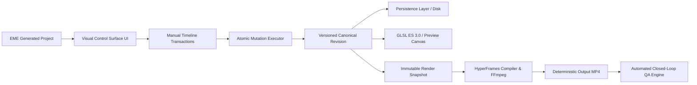

# Milestone RT-01 Baseline Architecture & Integration Map

## 1. Executive Summary
Milestone RT-01 (Phase 19) establishes the **End-to-End Workflow Integration and Deterministic Delivery** contract for the Editing Mechanics Engine (EME). It proves that the complete editing path:
$$\text{Generated Edit} \longrightarrow \text{Manual Timeline NLE} \longrightarrow \text{Persistence (Save/Reload)} \longrightarrow \text{GPU Preview} \longrightarrow \text{Deterministic Headless Render} \longrightarrow \text{Media QA}$$
operates as a unified, mathematically consistent, and revision-safe system.

---

## 2. Integration Pipeline Topology

### Integrated Systems:
1. **Canonical State Authority**:
   - `schema/eme-project.v1.schema.json` remains the authoritative project contract.
   - `schema/eme-color-grade.v1.schema.json` defines the canonical grading specification.
   - Project revision is monotonically incremented on every committed atomic transaction.
2. **Interactive Manual Timeline (`src/engine/timeline-adapter.js`, `src/ui/public/`)**:
   - Multitrack NLE with frame-accurate scrubbing, magnetic snapping, non-destructive trimming, ripple edit, slip, slide, split at playhead (`Cmd+B`), track locking, and audio waveform caching.
3. **Intelligent Color Grading Engine (`src/engine/color-operations.js`, `src/engine/lut-evaluator.js`)**:
   - Linear exposure compensation, CCT temperature/tint auto white-balance, primary LGGO, cubic spline contrast, 8-channel selective HSL, vectorscope skin-tone protection ($123^\circ$ I-line), and tetrahedral 3D LUT try-on.
4. **Immutable Snapshotting Engine (`src/ui/server.js`)**:
   - At render submission time, `structuredClone` captures the exact revision snapshot.
   - Subsequent user edits occurring during rendering advance the live project revision without corrupting the active render job.
5. **Deterministic Headless Compiler & Media QA (`src/renderers/`)**:
   - `HyperFramesCompiler` & `HyperFramesRenderer` produce frame-accurate MP4 deliverables.
   - `QualityAssuranceEngine` audits visual clipping, audio levels, and container conformance.
