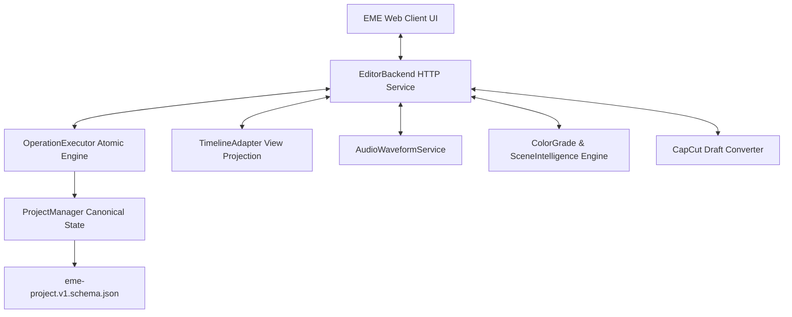

# Milestone TL-01 Baseline Architecture & System Specification

## 1. Executive Summary
Milestone TL-01 (Phase 18) delivers the **Interactive Manual Timeline Engine** for the Editing Mechanics Engine (EME). It provides a high-performance, multitrack Non-Linear Editor (NLE) surface featuring frame-accurate scrubbing, magnetic snapping, non-destructive editing operations (head/tail trim, ripple trim, split at playhead, slip, slide, track reorder, mute/lock), live audio waveform visualization, a professional Color Grading Inspector panel, and a reverse-engineered importer for macOS CapCut desktop draft projects (`draft_info.json`).

---

## 2. Component Topology

### Core Subsystems:
1. **`TimelineAdapter` (`src/engine/timeline-adapter.js`)**:
   - Converts canonical project state into view-ready display geometry (`leftPx`, `widthPx`, SMPTE timecode).
   - Real-time magnetic snap computation against clip boundaries (in/out) and playhead with configurable pixel/tick threshold.
   - CapCut draft converter transforming microsecond integer timeranges into canonical 120,000 ticks/sec with exact rational conversion ($25/3$).
2. **`OperationExecutor` Extensions (`src/engine/operations.js`)**:
   - `ripple_trim`: Trims clip head or tail while automatically rippling all downstream clips forward or backward with collision detection.
   - `slip_clip`: Slips media source `trimInTick`/`trimOutTick` without moving timeline placement or affecting adjacent clips.
   - `slide_clip`: Translates clip on timeline while expanding/contracting neighboring clips to maintain seamless adjacent boundaries without gaps.
   - `split_clip`: Splits clip into two contiguous segments at exact integer tick boundary with auto-generated new clip ID.
   - `set_track_state`: Mutates track `muted`, `locked`, `visible` properties.
   - `attach_color_grade`: Attaches CG-01 color grading contract to clip or project master.
   - `_assertTrackNotLocked`: Atomic mutation guard rejecting edits on locked tracks with stable error code `TRACK_LOCKED`.
3. **`AudioWaveformService` (`src/engine/audio-waveform.js`)**:
   - High-performance peak extraction and multi-level caching for instantaneous waveform rendering in timeline clip blocks.
4. **`EditorBackend` (`src/ui/server.js`)**:
   - RESTful endpoints: `/api/timeline`, `/api/waveform`, `/api/color-grade`, `/api/color-grade/save`, `/api/scene-analysis`, `/api/capcut/import`, `/api/project/operation`, `/api/project/undo`, `/api/project/redo`.
5. **Interactive UI (`src/ui/public/`)**:
   - Modern dark-mode interface with Inter and JetBrains Mono typography.
   - Multitrack lanes with drag-trim handles, magnetic snap guidelines, and SMPTE timecode ruler.
   - Color Grading tab with live sliders for Exposure, Temp/Tint White Balance, Primary LGGO, 3D LUT Try-On selector, and Vectorscope Skin Protection.
   - CapCut Draft Import dialog with 1-click sample demo.

---

## 3. Reverse Engineering CapCut Desktop Integration (REA)
From reverse-engineering CapCut macOS desktop application and drafts stored at `~/Movies/CapCut/User Data/Projects/com.lveditor.draft/`:
- **Timing Model**: CapCut drafts use integer microsecond timeranges (`source_timerange`, `target_timerange` with `start` and `duration`).
- **Rational Conversion**: EME uses 120,000 ticks per second ($1 \text{ tick} = 8.333\dots \mu s$). The conversion ratio is exact:
  $$\frac{1,000,000}{120,000} = \frac{25}{3}$$
  Forward: $t_{\mu s} = \operatorname{round}\left( \frac{25 \cdot t_{\text{ticks}}}{3} \right)$
  Inverse: $t_{\text{ticks}} = \operatorname{round}\left( \frac{3 \cdot t_{\mu s}}{25} \right)$
- **Draft Schema Mapping**:
  - `materials.videos` $\to$ EME `assets` (type `video`, integer duration in ticks).
  - `tracks[type="video"|"audio"]` $\to$ EME `tracks` (`kind: visual | audio`).
  - `segments` $\to$ EME `clips` with `source.trimInTick`, `source.trimOutTick`, `startTick`, `durationTicks`.
  - `segment.clip.transform` $\to$ EME `clip.transform` (`position`, `scale`, `rotation`, `opacity`).
