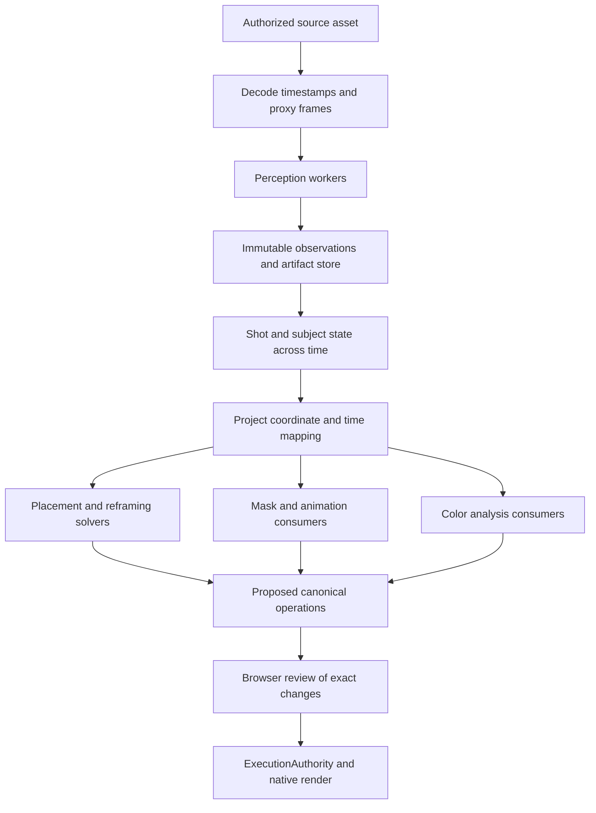

# EME visual understanding architecture

Status: architecture target, 2026-10-30. The first scene contract, anchored tracking adapter, Studio preview, and IDE query are now implemented; see [prototype setup and scope](../studio/SCENE.md). The broader capabilities and APIs marked proposed below remain design targets. Scene v1 currently supports one selected track and the visible/lost/unknown/cut states.

EME should analyze a source clip once, keep a versioned account of its subjects and motion, and let multiple editing tools consume that evidence. Begin with subject identity, position, visibility, and motion. Add segmentation masks, geometry, and color measurements when a consumer needs them. No CorridorKey or chroma-key integration is part of this design.

## System boundary

Perception estimates what is present. Temporal state associates observations. Solvers decide how a requested edit should behave. The existing approval and execution boundary commits that decision. A worker never edits the canonical project.

Dense model features and the scene representation are different things. A feature tensor can help a detector or tracker, but does not automatically supply named objects, metric depth, or masks. Providers must explicitly decode and declare the observations they produce. Store heavy tensors and images as artifacts; give the IDE compact, typed summaries.

## Four useful kinds of scene evidence

| Evidence | First useful representation | Consumers | Boundary |
| --- | --- | --- | --- |
| Semantics and identity | User-selected or detected subject, persistent track ID, class and label origin | Subject protection, title placement, selection | A user label is not a classifier result; identity is within a shot, not biometric identity. |
| Motion | Observed bounds, displacement, timing, optional camera transform | Tracking, stable crop paths, keyframe suggestions | Camera compensation is not a 3D camera solve or eye-gaze measurement. |
| Depth | Optional depth artifact and declared relative or metric units | Layer ordering, occlusion-aware graphics | Relative depth must not be presented as measured distance. |
| Surface orientation | Optional normals or plane estimate with coordinate convention | Graphics attached to a surface | Reliable attachment also needs correspondences and camera geometry. Normals alone are insufficient. |

Segmentation, soft alpha, and color statistics are additional typed outputs. A boolean subject region is not fractional transparency. Neither should be inferred merely because a provider produces boxes. No consumer assumes all capabilities exist.

## Reuse the existing code through explicit adapters

| Existing component | Role in the design | Required work |
| --- | --- | --- |
| `schema/eme-visual-intelligence.v1.schema.json` and `src/renderers/visual-contract-validator.js` | Legacy frame-observation input | Preserve its contract. Convert integer confidence to a clearly tagged raw score; verify coordinates and source hash. It cannot represent all new states. |
| `src/engine/vtsm-service.js` and `vtsm-state-manager.js` | Candidate tracking adapter | Preserve shot, motion, and visibility information from the worker. Current normalization drops some fields; current default worker output does not persist its internal masks. |
| `experiments/visual-temporal-state/src/tracker/pipeline_vtsm03.py` | Candidate real tracking provider | Validate prerequisites, checkpoint identity, actual observations, occlusion handling, and performance on real footage. It is not yet a Studio provider. |
| `src/solver/visual-constraint-solver.js` | Spatial and temporal decisions | Adapt the scene query and output operation shape. Test requested intervals and raster bounds. |
| `src/creative/reframing-engine.js` | Crop-path planning | Connect truthful observations and implement the required dynamic crop export support. |
| `src/studio/server.js` and `src/creative/execution-authority.js` | Review and commit | Include evidence bindings in proposals and recheck them before execution. |
| `src/renderers/canonical-native.js` | Authoritative rendering | Add support and checks per consumer. Animated face-safe placement, dynamic crop paths, matte compositing, and enabled color grades are not all currently supported. |

Do not use `src/renderers/vision-worker-bridge.py` as a production detector. It contains synthetic benchmark behavior. Legacy provenance also contains declared defaults, including model metadata; a declared hash is not proof that those exact weights executed. An adapter must preserve that distinction rather than relabeling old data as verified.

## Proposed scene contract

Keep the canonical project schema unchanged. Define a separately versioned scene-analysis document with these required sections:

| Section | Required contents |
| --- | --- |
| Source | Asset hash, byte identity, decoded dimensions, orientation, decode profile, requested source interval |
| Time mapping | Original presentation timestamps and time base, derived 120000-tick timestamps, frame intervals, sampling policy |
| Provenance | Provider and code version, verified weight hashes when used, preprocessing, settings, device/backend, run identity, fixture/manual/model origin |
| Capabilities | Signal availability by provider and run: available, unavailable, not requested, failed, or partial; reason and coverage |
| Shots | Half-open source intervals, detected or user-confirmed boundaries, boundary uncertainty |
| Tracks | Shot-scoped persistent IDs, label and origin, association diagnostics, selection history |
| Frame states | Visibility, observed geometry, optional predicted geometry, observation origin, raw confidence and calibration status |
| Artifact references | Content hash, type, dimensions, coordinate space, source interval/frame, producer, encoding, and registry ID |
| Diagnostics | Gaps, drift, identity conflicts, discarded outputs, cancellation/failure details |

A frame state distinguishes `visible`, `partially_occluded`, `occluded`, `out_of_frame`, `lost`, and `unknown`. Track prediction and direct observation remain separate. Fully occluded states have no observed visible mask. A separately identified prediction can support a preview, but cannot pass a consumer that requires observed coverage.

Confidence is provider-specific and initially uncalibrated. It is not a universal probability of correctness. Preserve detection, association, and visibility scores separately where supplied. Thresholds belong to a consumer policy validated against representative footage.

Do not store absolute file paths in agent-facing artifact references. The local registry resolves IDs, validates checksums, and enforces source ownership. A mask reference declares whether it is binary segmentation or soft alpha. Depth declares units; normals declare axes; color data declares its working space. Optional learned features additionally declare tensor shape and encoding.

## Time and coordinate rules

1. Use actual presentation timestamps, including variable-frame-rate inputs. Frame index divided by nominal FPS is not an authoritative timestamp. Preserve original rational timing and explicitly round when mapping to EME ticks.
2. Treat intervals as `[startTick, endTick)`. Sparse samples do not establish complete coverage between them. Never silently hold the last detection through an unobserved gap.
3. Normalize observations into the displayed source image after declared orientation handling. Keep the exact proxy-to-source transform, including crop and padding. Legacy coordinates require a verified adapter.
4. Map source evidence into a project using source trims, timeline offsets, crop, scale, and other supported transforms. Speed ramps or transforms without a verified mapping make the consumer unavailable.
5. Raster bounds and evidence must use the same transform. A source-space face box cannot be compared directly with a canvas-space title.
6. Reset association and smoothing at hard cuts. Ambiguous transitions get a diagnostic or explicit boundary correction. Do not merge identities across shots merely because subjects look similar.

## Temporal behavior

Offline analysis can use earlier and later frames within a shot. Detection or user prompts establish anchors; a tracker associates them and reports drift or occlusion. Optical flow can support propagation, while re-detection and user corrections can reset a failing track. Store a corrected result as a new analysis revision and retain the old artifact identity.

Start with a single stable title position across the requested interval. A temporal solver may later suggest motion, penalizing unnecessary movement and abrupt acceleration. If no safe position exists, return an infeasible result with alternatives. No hidden relaxation should remove the subject-protection requirement.

User selection is the first practical identity mechanism: choose a subject in an anchor frame, preview its propagated track, and correct it where necessary. Automatic subject ranking can follow after reliable tracking. None of this requires training a new foundation model.

## Cache and invalidation

Analysis cache identity includes source hash, decode/preprocessing profile, provider/code and weight identities, settings, selected interval, requested signals, and subject hints. The resulting artifacts have separate content hashes. Include generated proxy identity and deterministic seed where relevant.

Layout-result identity additionally includes project revision, source trims, canvas/crop transforms, text, font bytes and raster bounds, consumer version, and constraints. Editing a title should reuse source analysis but invalidate its placement. Replacing footage, changing hints, changing a model, or changing preprocessing invalidates the relevant analysis.

Expensive jobs run in a separate bounded worker, following Studio's render-worker pattern. Queue, cancellation, and completion are explicit. Partial output is distinguishable from a complete result; a failed or cancelled run does not replace the last verified result. Recheck asset identity on completion before registering output.

## Proposed service operations

These are internal design interfaces, not currently registered MCP tools:

- `requestAnalysis({assetId, sourceRange, signals, subjectHints})` returns a job and immutable request fingerprint. The server supplies authorized paths and verifies media identity.
- `getAnalysisStatus({jobId})` reports availability, completed coverage, diagnostics, and artifact identity.
- `queryScene({analysisId, sourceRange, trackIds, requiredSignals, coveragePolicy})` returns compact source-space scene evidence or an explicit insufficiency result.
- `mapSceneToProject({analysisId, projectSnapshot, clipId, timelineRange})` returns the transformed view and its binding fingerprint.
- `proposeVisualEdit({projectSnapshot, mappedEvidence, intent, constraints})` returns canonical operations and evidence requirements for Studio review.

Requests for unsupported geometry or masks return unavailable. Production queries reject synthetic fixtures. Precomputed or user-provided observations retain their origin and validation status; schema validity does not prove detection accuracy.

At review, show which subject and interval informed the edit, its proposed movement, evidence gaps, and correction options. At execution, bind the project snapshot, source identity, analysis artifact, mappings, and consumer policy. At render, verify capabilities and artifact integrity. Do not rely on a title-safe result computed before the user changed the crop or font.

## First implementation slice

1. Add the versioned scene contract, semantic validator, immutable artifact registry, and adapters. Test stale bindings, coverage gaps, source/timeline mapping, synthetic rejection, and state distinctions.
2. Benchmark the real tracking experiment on this M3 using short proxies and an explicit anchor selection. No model choice or speed claim is accepted from an experiment name alone. Missing prerequisites return unavailable, never synthetic fallback.
3. Connect analysis status, track overlays, timeline scrubbing, and corrections to Studio. Expose compact scene queries to the local IDE agent; leave raw tensors outside prompts.
4. Connect the spatial solver for one static placement over the full title interval, using actual raster bounds. Reuse Studio's proposal and approval flow.
5. Add animated placement and reframing only after native export can enforce the corresponding geometry and temporal constraints. Add masks, depth/normals, and grading as separate capability increments.

The first acceptance example is a user-selected speaker moving through a short shot: the same subject keeps its track identity, occlusion becomes explicit uncertainty, a title is placed clear of verified subject regions, and the exported result matches the reviewed position. Where complete coverage is unavailable, the result requests correction instead of claiming safety.

Evaluate real footage with cuts, occlusions, multiple similar subjects, camera movement, blur, low light, empty frames, and rotated/VFR inputs. Record identity switches, coverage, subject overlap, crop retention, jitter, correction time, latency, and peak memory. Keep synthetic tests for deterministic contracts and real footage for perception quality; neither substitutes for the other.
