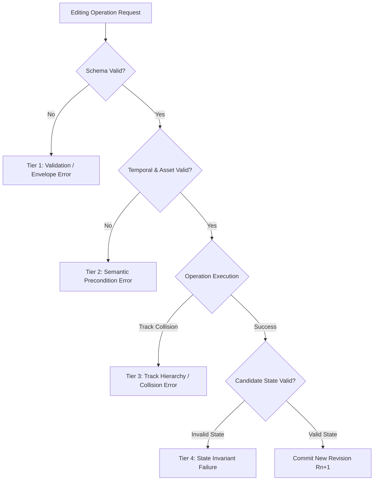

# Phase 11 Failure Taxonomy & Recovery Invariants

## 1. Classification of Failure Modes

The EME architecture classifies operational errors into four deterministic tiers:

---

## 2. Tested Negative Fixtures & Observed Behavior

| Fault ID | Scenario Description | Error Code | Observed Behavior | State Invariant |
|---|---|---|---|---|
| **F-01** | Missing referenced asset ID | `ASSET_NOT_FOUND` | Operation rejected immediately before mutating candidate. | Revision preserved at 1; zero disk write. |
| **F-02** | Unsupported renderer effect | `VALIDATION_FAILED` | Schema validator rejects effect enum during preflight. | Revision preserved at 1; candidate discarded. |
| **F-03** | Invalid trim bounds ($t_{\text{in}} \ge t_{\text{out}}$) | `INVALID_TRIM_RANGE` | `_opTrimClip` checks boundary condition and throws typed error. | Revision preserved at 1; zero clip truncation. |
| **F-04** | Keyframe timing out of bounds | `KEYFRAME_OUT_OF_BOUNDS` | `_opAnimateProperty` bounds check rejects offset. | Revision preserved at 1; keyframes untouched. |
| **F-05** | Track overlap collision | `TRACK_COLLISION` | Half-open collision engine detects interval overlap. | Revision preserved at 1; zero track displacement. |
| **F-06** | Malformed null envelope | `INVALID_ENVELOPE` | Top-level dispatcher rejects falsy operation payload. | Revision preserved at 1; clean failure return. |
| **F-07** | Unknown operation type | `UNSUPPORTED_OPERATION` | Switch dispatcher default case triggers error return. | Revision preserved at 1; zero side effects. |
| **F-08** | Subsequent valid operation recovery | `SUCCESS` | Subsequent valid `modify_clip` cleanly executes. | Revision increments to 2; state fully valid. |

---

## 3. Atomic Guarantees
Every operation execution enforces deep-cloning prior to mutation (`structuredClone`). If any validation step, schema check, or track collision check fails:
1. The modified candidate is discarded immediately.
2. The original project reference is returned untouched.
3. The project revision number is **never** incremented.
4. No temporary composition files are persisted to disk.
