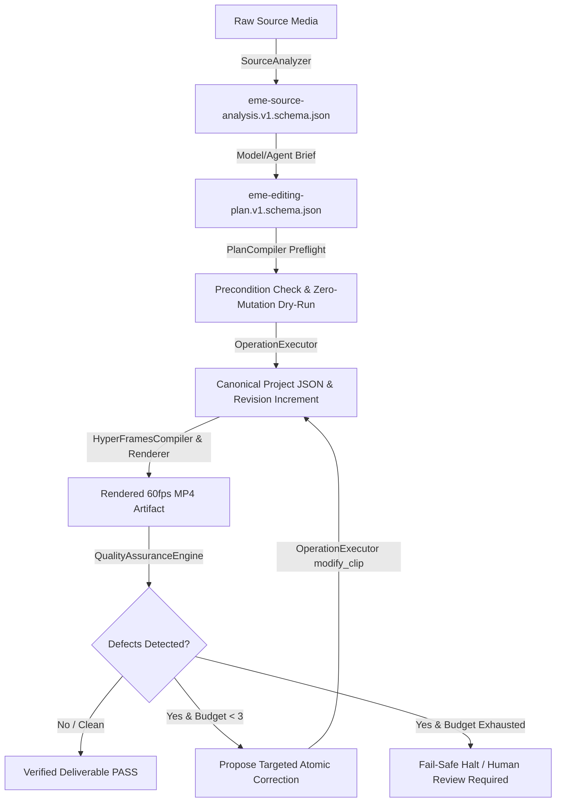

# Phase 13 Architecture & Evidence-Grounded Editing Design

**Document:** `docs/phase-13-architecture.md`  
**Date:** 2026-10-16  
**Status:** ARCHITECTURE DESIGN  
**Author:** AI-Operated Video Editing Mechanics Engine (EME) Core Engineering Team  

---

## 1. Architectural Principles

Phase 13 establishes the formal **Evidence-to-Render-to-Correction Pipeline**, closing the loop between source analysis, intermediate plan compilation, deterministic execution, and closed-loop creative verification.

---

## 2. Three Distinct Core Representations

To prevent semantic corruption and model hallucinations, EME enforces strict separation between three distinct layers:

1. **Source Analysis (`schema/eme-source-analysis.v1.schema.json`)**:
   - Represents *observed immutable facts* of media on disk.
   - SHA-256 digests, file sizes, container streams, rational frame rates, exact candidate keyframes, true RMS / peak audio levels.
   - Never contains creative intentions or editing decisions.

2. **Editing Plan (`schema/eme-editing-plan.v1.schema.json`)**:
   - Represents *creative brief, intentions, narrative acts, and planned operations*.
   - Explicitly links to source analysis (`sourceAnalysisId`, `evidenceRationale`, `sourceTimestampSec`).
   - Free from timeline-internal state mutations (e.g. tracks, z-indexes, clip id mappings).

3. **Canonical Project (`schema/eme-project.v1.schema.json`)**:
   - The strict, low-level integer timebase (120,000 ticks/sec) project state.
   - Maintained through atomic, versioned operations ($R_0 \to R_N$).
   - Never contains HTML/CSS/GSAP markup or loose model commentary.

---

## 3. Closed-Loop QA Feedback Architecture

The `ClosedLoopQaPipeline` implements bounded automated repair:
- **Max Budget:** 3 attempts.
- **Cycle:**
  1. Render candidate composition.
  2. Audit via `QualityAssuranceEngine` (aspect ratio, asset presence, font declarations, text boundary clipping, audio loudness).
  3. Map warnings to typed findings (`LAYOUT_CLIPPING`, `MISSING_FONT_ASSET`, etc.).
  4. Formulate targeted atomic correction operations (e.g., adjust `transform.x` to canvas midpoint, scale down `fontSize` by factor of 0.7).
  5. Apply atomically via `OperationExecutor.execute(modify_clip)` and advance revision.
  6. Rerender and re-audit until clean or budget exhausted.
