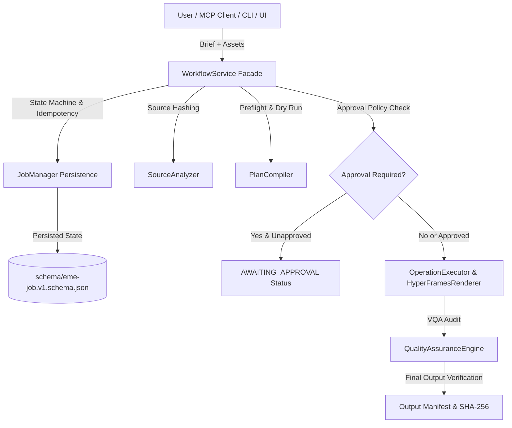

# Phase 14 Architecture & Durable Job Lifecycle Specification

**Document:** `docs/phase-14-architecture.md`  
**Date:** 2026-10-16  
**Status:** ARCHITECTURAL SPECIFICATION  
**Author:** AI-Operated Video Editing Mechanics Engine (EME) Core Engineering Team  

---

## 1. Architectural Overview

Phase 14 delivers the **Production Workflow Orchestration Layer**, elevating EME from an ad-hoc rendering script collection to an auditable, recoverable production system.

---

## 2. Shared Service Boundary (`src/orchestration/service-boundary.js`)

All entry points (CLI `bin/eme.js`, MCP Server `src/mcp/server.js`, and Visual UI `src/ui/server.js`) share the single unified `WorkflowService`.

- **Atomic state updates:** Transitions are verified against valid state progressions before execution.
- **Fail-safe recovery:** If any rendering or compilation fault occurs, project state reverts cleanly with zero partial file corruption.
- **Explicit Approval Policy:** Destructive changes, asset re-linking, or unverified visual effects halt the job in state `AWAITING_APPROVAL` until an authorized user or client signs off.
