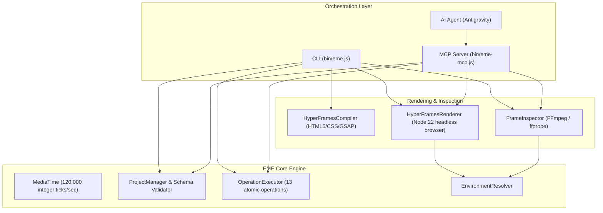

# Architecture & Runtime Requirements

**Release Candidate**: `v0.1.0-rc1`  

---

## 1. System Architecture

---

## 2. Runtime Requirements

### Minimum & Recommended Versions
- **Node.js**:
  - Minimum supported: `>= 20.0.0`
  - Recommended: `>= 22.12.0` (for direct HyperFrames execution without delegation)
- **FFmpeg**: `5.0+` (tested with `FFmpeg 9.0.2` on macOS Darwin)
- **ffprobe**: Matching FFmpeg build
- **HyperFrames**: `0.8.162`
- **Supported OS**: macOS Darwin (arm64 / x64), Linux (x64)
