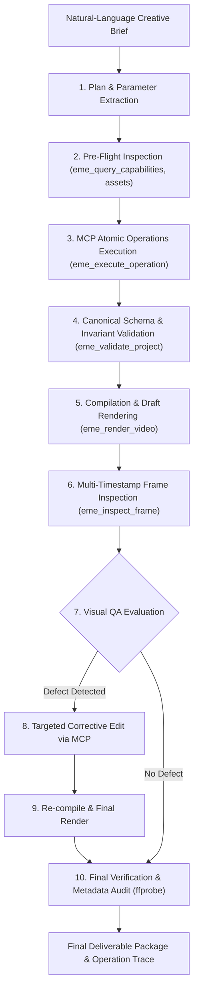

# Agent-Driven Automated Production Workflow Specification

**System**: Editing Mechanics Engine (EME)  
**Document Version**: 1.0.0  
**Status**: APPROVED & IMPLEMENTED (`src/agent/agent-production.js`)  
**Target Environment**: Google Antigravity & Model Context Protocol (MCP)  

---

## 1. Overview & Architectural Principle

The central requirement of Phase 5 is that **Antigravity makes the creative and analytical decisions**, while **EME validates and executes editing operations**.

The agent must never bypass EME by generating ad-hoc HTML documents, arbitrary FFmpeg filtergraphs, or private parallel timelines. All creative instructions must be translated into validated canonical project states via typed MCP operations.



---

## 2. Step-by-Step Production Lifecycle

### Step 1: Brief Understanding & Creative Parameter Extraction
When the agent receives a natural-language brief, it extracts:
- Target resolution and aspect ratio (e.g., 1080×1920 vertical 9:16).
- Exact duration and timebase (e.g., 6.0 seconds = 720,000 integer ticks at 120,000 ticks/sec).
- Framerate (e.g., 60 fps constant).
- Visual hierarchy (primary headline, secondary subtitle, accent typography).
- Verified assets (fonts, video, audio) - no invented or missing assets permitted.
- Transitions and keyframed animations.

### Step 2: Pre-Flight Inspection
Before mutating any state:
- Query renderer capabilities (`eme_query_capabilities`) to verify requested blend modes, filters, and animatable properties are natively supported.
- If editing an existing project, call `eme_inspect_project` to read the current revision, track IDs, clip IDs, and time intervals.

### Step 3: Structured Editing Plan Generation
The agent formulates a discrete, ordered plan of typed EME operations:
```json
[
  { "step": 1, "tool": "eme_create_project", "args": { "title": "...", "width": 1080, "height": 1920, "fps": { "numerator": 60, "denominator": 1 }, "durationTicks": 720000 } },
  { "step": 2, "tool": "eme_execute_operation", "operation": { "type": "add_asset", "params": { "id": "font-instrument", "type": "font", "src": "..." } } },
  { "step": 3, "tool": "eme_execute_operation", "operation": { "type": "add_track", "params": { "id": "track-hero", "kind": "visual", "zIndex": 10 } } },
  { "step": 4, "tool": "eme_execute_operation", "operation": { "type": "insert_clip", "params": { "id": "clip-hero-1", "trackId": "track-hero", ... } } }
]
```

### Step 4: Atomic Execution & Revision Tracking
- Each step is executed sequentially via MCP.
- The project revision increments monotonically with each successful operation.
- If any operation fails, the operation executor aborts and restores the previous valid revision (fail-closed rollback guarantee).

### Step 5: Draft Rendering
- The candidate project is compiled into a HyperFrames composition and rendered to `agent-draft.mp4`.
- Frame rate is strictly enforced via `--fps=60` and `data-fps="60"`.

### Step 6: Multi-Timestamp Frame Inspection
The agent extracts lossless PNG frames at three or more representative timestamps:
1. **Entrance Timestamp** ($t = 1.0\text{s}$): Verifies initial typography visibility and entrance animation.
2. **Mid-Point Evaluation** ($t = 2.0\text{s}$): Verifies compositional balance, font size hierarchy, and legibility.
3. **Transition / Scene Change** ($t = 3.0\text{s}$): Verifies clean scene cut or crossfade.
4. **Final Scene Composition** ($t = 5.0\text{s}$): Verifies secondary scene text and hold.

### Step 7: Targeted Visual Correction
- When visual inspection reveals an issue (e.g., subtitle text is undersized or low-contrast for mobile screens):
  1. The agent formulates a targeted corrective edit (e.g., replace clip with higher font size and contrast).
  2. The edit is applied via `delete_clip` followed by `insert_clip` and `animate_property`.
  3. The project revision increments cleanly.
  4. The candidate is re-validated.

### Step 8: Final Render & Verification
- Final project is rendered to `agent-final.mp4`.
- Frames are re-extracted to confirm defect resolution.
- Container and stream metadata is probed via `ffprobe` to verify:
  - Exact duration (6.000s).
  - Exact frame count (360 frames @ 60fps).
  - Valid audio stream with active volume envelopes.
- Production trace is saved as an immutable audit log (`production-trace.json`).

---

## 3. Existing Project Modification Invariants

When an agent edits an existing project:
1. **Selective Modification**: Only target clips/properties are modified.
2. **State Preservation**: All unrelated clips, tracks, effects, and assets remain bit-for-bit identical.
3. **ID Stability**: Clip and track IDs are preserved unless an operation explicitly removes them.
4. **Revision Monotonicity**: Revisions advance sequentially with each mutation.
5. **No State Discarding**: The agent never reconstructs a project from scratch when asked to perform a bounded edit.
