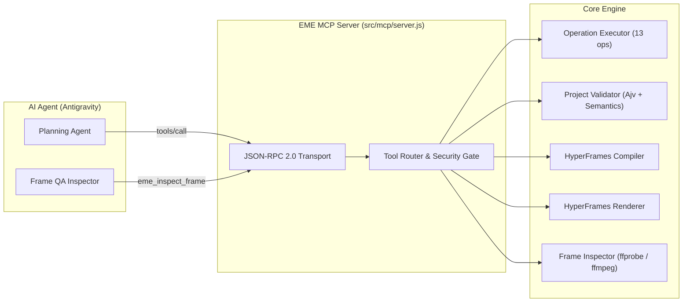

# Model Context Protocol (MCP) Interface Specification

**System**: Editing Mechanics Engine (EME)  
**Document Version**: 1.0.0  
**Dialect**: JSON-RPC 2.0 over `stdio`  
**Protocol Version**: `2024-11-05`  
**Host Application**: Antigravity IDE & Autonomous Agent Workflow  

---

## 1. Overview

The EME Model Context Protocol (MCP) server provides a deterministic, typed bridge between the AI agent orchestration layer (Google Antigravity) and the Editing Mechanics Engine. It exposes the engine's 13 atomic editing operations, schema validators, compiler, HyperFrames renderer adapter, and frame inspection facilities without allowing the agent to bypass domain invariants or execute arbitrary host shell commands.

---

## 2. Server Architecture & Transport

The server is implemented in `src/mcp/server.js` and communicates via standard I/O (`stdio`):



### Transport Conventions
1. **Request Format**: Standard JSON-RPC 2.0 object with `jsonrpc: "2.0"`, integer `id`, `method`, and `params`.
2. **Response Format**: Standard JSON-RPC 2.0 response with `result: { content: [{ type: "text", text: JSON_STRING }] }` or structured `error`.
3. **Path Security Gate**: All file paths supplied to tools are checked against authorized project workspace roots. Path traversal outside authorized boundaries is rejected with a structured security violation error.

---

## 3. Protocol Methods

### 3.1 `initialize`
Initializes the session and declares server capabilities.
```json
{
  "jsonrpc": "2.0",
  "id": 1,
  "method": "initialize",
  "params": {}
}
```
**Response Result**:
```json
{
  "protocolVersion": "2024-11-05",
  "serverInfo": {
    "name": "eme-mcp-server",
    "version": "0.1.0"
  },
  "capabilities": {
    "tools": {}
  }
}
```

### 3.2 `tools/list`
Returns the complete catalog of registered EME tools, their descriptions, and strict JSON Schema definitions for their arguments.

---

## 4. Tool Catalog

### 4.1 State-Changing & Project Operations

#### `eme_create_project`
Initializes a new canonical EME video editing project with canvas dimensions, timebase, and default tracks.
- **Arguments**:
  - `title` (*string*): Human-readable project title.
  - `width` (*integer*, default: 1080): Canvas width in pixels.
  - `height` (*integer*, default: 1920): Canvas height in pixels.
  - `fps` (*object*): `{ numerator: number, denominator: number }`.
  - `durationTicks` (*integer*, default: 360000): Duration in 120,000 integer ticks/sec.
  - `backgroundColor` (*string*, default: "#0a0a0d"): Canvas hex color.
- **Returns**: `{ success: true, project: CanonicalProject }`.

#### `eme_execute_operation`
Executes one of the 13 catalog atomic editing operations against an in-memory project state with rollback guarantees.
- **Arguments**:
  - `project` (*object*, required): Current canonical project state.
  - `operation` (*object*, required):
    - `type` (*string*): One of `add_asset`, `remove_asset`, `add_track`, `remove_track`, `reorder_tracks`, `insert_clip`, `trim_clip`, `move_clip`, `split_clip`, `delete_clip`, `ripple_delete`, `add_keyframe`, `apply_effect`, `set_audio_envelope`.
    - `params` (*object*): Operation-specific typed parameters.
- **Returns**: `{ success: true, project: CanonicalProject, affectedIds: string[] }` or `{ success: false, code: string, error: string }`.

---

### 4.2 Validation & Query Tools

#### `eme_validate_project`
Runs canonical schema validation (JSON Schema draft-07 via Ajv) and domain invariant validation (temporal overlaps, asset references, track existence, tick bounds).
- **Arguments**:
  - `project` (*object*, required): Canonical project.
- **Returns**: `{ valid: boolean, errors: string[] }`.

#### `eme_inspect_project`
Reads an existing canonical project from disk or memory, returning a high-level summary of tracks, clips, assets, revision count, and validation status.
- **Arguments**:
  - `projectPath` (*string*, optional): Path to project JSON file.
  - `project` (*object*, optional): In-memory project object.
- **Returns**: Summary object with `id`, `title`, `revision`, `width`, `height`, `fps`, `durationTicks`, `tracksCount`, `clipsCount`, `assetsCount`, `validation`.

#### `eme_query_capabilities`
Queries the active renderer's supported media types, blend modes, filters, and animatable properties.
- **Arguments**: `{}`.
- **Returns**: `{ formats, mediaTypes, blendModes, filters, properties, easings }`.

---

### 4.3 Rendering & Inspection Tools

#### `eme_compile_composition`
Compiles canonical project state into a self-contained HyperFrames HTML/CSS/GSAP composition bundle.
- **Arguments**:
  - `project` (*object*, required): Validated canonical project.
  - `outputDir` (*string*, required): Directory to write composition files.
- **Returns**: `{ outputDir, entryHtmlPath, durationSeconds, fps, clipCount }`.

#### `eme_render_video`
Compiles project and invokes the local HyperFrames renderer to produce a constant-frame-rate MP4 video.
- **Arguments**:
  - `project` (*object*, required): Validated canonical project.
  - `outputMp4Path` (*string*, required): Destination MP4 file path.
  - `fps` (*number*, optional): Explicit framerate override.
- **Returns**: `{ success: true, outputPath, elapsedMs, metadata: { duration, fps, width, height, nbFrames } }`.

#### `eme_inspect_frame`
Extracts a lossless still PNG frame from a rendered MP4 at an exact timestamp or integer tick.
- **Arguments**:
  - `videoPath` (*string*, required): Path to rendered MP4.
  - `outputPngPath` (*string*, required): Destination PNG path.
  - `time` (*number*, optional): Timestamp in seconds.
  - `tick` (*integer*, optional): Timestamp in integer ticks.
- **Returns**: `{ success: true, framePath, timestampSec, sizeBytes }`.

#### `eme_inspect_metadata`
Probes container and stream metadata of a video file using `ffprobe`.
- **Arguments**:
  - `videoPath` (*string*, required): Path to video file.
- **Returns**: `{ success: true, duration, sizeBytes, video: { codec, width, height, fps, nbFrames }, audio: { codec, channels } }`.

---

## 5. Error Codes & Rollback Guarantee

When any tool encounters invalid input, missing dependencies, or schema violations:
1. The error returns a non-zero code or `{ success: false, code: "...", error: "..." }`.
2. Project state is never mutated; the candidate clone is discarded, and the original project revision remains unchanged.
3. Common error codes:
   - `UNKNOWN_OPERATION`: Unrecognized operation type.
   - `INVALID_ARGUMENT`: Missing required parameters or type mismatch.
   - `CLIP_COLLISION`: Operation would violate non-overlapping track invariant.
   - `TRACK_NOT_FOUND`: Referenced trackId does not exist.
   - `ASSET_NOT_FOUND`: Referenced assetId does not exist.
   - `SECURITY_VIOLATION`: Path escapes authorized workspace root.
