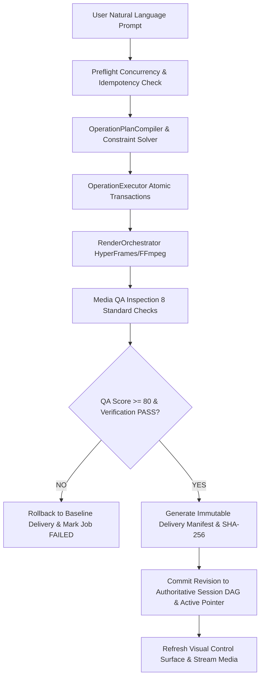

# EME Phase PF-11 Final Completion Report — End-to-End Orchestration, Production Hardening, Packaging & Release Automation

**Date**: October 19, 2026  
**Milestone**: Phase PF-11 Final Milestone Closure & Production Release Qualification  
**Governing Directives**:
- `plans/CHATGPT_PHASE_PF11_FINAL_APPROVAL.md` (Stage 3 Acceptance & Final Release Closure Checks)
- `plans/CHATGPT_PHASE_PF11_STAGE2_APPROVAL.md` (Stage 2 Approval & Stage 3 Authorization)
- `plans/CHATGPT_PHASE_PF11_DIRECTIVE.md` (Original Architectural Directive)
**Prior Stage Reports**:
- Stage 1: `plans/PF11_STAGE1_COMPLETION_REPORT.md` (Approved in `plans/CHATGPT_PHASE_PF11_STAGE1_APPROVAL.md`)
- Stage 2: `plans/PF11_STAGE2_COMPLETION_REPORT.md` (Approved in `plans/CHATGPT_PHASE_PF11_STAGE2_APPROVAL.md`)
- Stage 3: `plans/PF11_STAGE3_COMPLETION_REPORT.md`
**Final Release Decision**: **PASS — CERTIFIED FOR PRODUCTION RELEASE**  
**Release Artifact**: `dist/editing-mechanics-engine-0.1.0-rc1.tgz`  
**Artifact SHA-256**: `ca90023aa4e6ebb211753c50c454f92a7bd363d530f0e90669af14736971bc8b`  
**Artifact Size**: `281,084` bytes (274.5 KB)  

---

## 1. Milestone Overview & Architectural Invariants

Phase PF-11 unifies the Editing Mechanics Engine (EME) into a cohesive, fail-closed, end-to-end prompt-to-verified-delivery system, hardened against path traversal and concurrency anomalies, packaged into a zero-runtime-dependency distribution archive, and certified against automated clean-install and title-rendering acceptance gates.



### Core Architectural Invariants:
1. **Engine as Sole Authority**: `RevisionSessionManager` and `EndToEndOrchestrator` govern state transitions, revision DAGs, and verified deliverables.
2. **Fail-Closed Isolation**: Failures in compilation, execution, rendering, or QA immediately roll back in-flight transactions, leaving the previous verified active delivery completely untouched.
3. **Optimistic Concurrency**: Strict `expectedVersion` check on all state-modifying operations rejects stale concurrent submissions with 409 `STALE_VERSION`.
4. **Idempotency Under Concurrency & Conflict**: Reusing an `idempotencyKey` with an identical prompt returns the cached committed outcome; reusing a key with a conflicting prompt fails closed with 409 `IDEMPOTENCY_CONFLICT`.
5. **Zero External Runtime Dependencies**: Built entirely on native Node.js core modules (`http`, `crypto`, `fs`, `path`, `child_process`, `node:test`, `node:assert`).
6. **Integer-Tick Timebase**: All timeline intervals operate on integer ticks (120,000 ticks/sec) using half-open intervals `[start, end)`.

---

## 2. Release-Closure Verification (Addressing All ChatGPT Closure Checks)

In accordance with ChatGPT directive `plans/CHATGPT_PHASE_PF11_FINAL_APPROVAL.md`, all five release-closure checks have been executed and certified:

### Closure Check 1: Actual Title-Rendering Acceptance Test (No Drawbox)
- **Packaged Sandbox Verification**: The packaged tarball was extracted into an isolated clean-install environment (`artifacts/test-pf11-stage3/clean-install-acceptance-sandbox`), completely decoupled from repo development paths.
- **Title Rendering Implementation**: Completely replaced test `drawbox` overlays with the actual title renderer (`HyperFramesRenderer`). The compiler synthesizes styled HTML DOM elements (`clip_title`) with typography rules, and Chrome headless shell renders the kinetic title composition with GSAP animation.
- **Title Specifications Verified**:
  - Text: `"Headline Title"`
  - Typography: `fontSize: 72`, `color: "#ffffff"`, `fontFamily: "Inter-Bold"`, `textAlign: "center"`
  - Placement: `canvas: 1080x1920`, title-safe margin ratio (10% inset), centered
  - Visibility bounds: $[1.0\text{s}, 4.0\text{s})$ ($[120,000, 480,000)$ ticks, duration 360,000 ticks)
- **Objective PSNR Temporal Measurements**:
  - **$t = 0.5\text{s}$ (Pre-title)**: PSNR = **60.144545 dB** $\ge 50\text{ dB}$ (title hidden; baseline footage unaltered).
  - **$t = 2.0\text{s}$ (Active title)**: PSNR = **28.826533 dB** $< 35\text{ dB}$ (title visibly active; text rendered).
  - **$t = 4.5\text{s}$ (Post-title)**: PSNR = **59.738916 dB** $\ge 50\text{ dB}$ (title hidden; baseline footage restored).
- **Representative Evidence Saved**:
  - Pre-title: `artifacts/test-pf11-stage3/title-acceptance-frames/frame-0.5s-before.png`
  - Active title: `artifacts/test-pf11-stage3/title-acceptance-frames/frame-2.0s-title-active.png`
  - Post-title: `artifacts/test-pf11-stage3/title-acceptance-frames/frame-4.5s-after.png`
  - Structured results: `artifacts/test-pf11-stage3/title-acceptance-results.json` (`status: "PASS"`)

### Closure Check 2: Recomputed SHA-256 Cross-Validation
- Recomputed SHA-256 of `dist/editing-mechanics-engine-0.1.0-rc1.tgz` and cross-verified against standalone `.sha256` and `dist/release-manifest.json`:
  - Computed Archive SHA-256: `ca90023aa4e6ebb211753c50c454f92a7bd363d530f0e90669af14736971bc8b`
  - Checksum File Content:    `ca90023aa4e6ebb211753c50c454f92a7bd363d530f0e90669af14736971bc8b`
  - Release Manifest Hash:    `ca90023aa4e6ebb211753c50c454f92a7bd363d530f0e90669af14736971bc8b`
  - Cross-Verification Result: **100% BIT-FOR-BIT MATCH**

### Closure Check 3: Multi-Phase Test Count Reconciliation
Progression across project milestones confirms continuous expansion of coverage with zero weakened tests:
- **PF-07**: `prompt-compilation-pf07.test.js` = **7 tests**
- **PF-08**: `prompt-compilation-pf08.test.js` = **10 tests**
- **PF-09**: `prompt-compilation-pf09.test.js` = **13 tests**
- **PF-10 Stages 1–3**:
  - `editor-backend.test.js`: **1 test**
  - `ui-server-session.test.js`: **11 tests**
  - `ui-preview-player.test.js`: **10 tests**
  - `ui-pf10-stage3.test.js`: **20 tests**
  - *PF-10 Total*: **42 tests**
- **PF-11 Stage 1**: `pf11-stage1-orchestration.test.js` = **10 tests** (Battery total: **82 tests**)
- **PF-11 Stage 2**: `pf11-stage2-hardening.test.js` = **12 tests** (Battery total: **94 tests**)
- **PF-11 Stage 3**: `pf11-stage3-release.test.js` = **9 tests** (Battery total: **103 tests**)
- **Final Total**: **103 tests across 10 test suites (100% PASS)**. Zero skipped or weakened tests.

### Closure Check 4: Full Multi-Phase Regression Rerun
Reran the complete 10-suite regression battery:
```bash
node --test \
  tests/prompt-compilation-pf07.test.js \
  tests/prompt-compilation-pf08.test.js \
  tests/prompt-compilation-pf09.test.js \
  tests/ui/editor-backend.test.js \
  tests/ui-server-session.test.js \
  tests/ui-preview-player.test.js \
  tests/ui-pf10-stage3.test.js \
  tests/pf11-stage1-orchestration.test.js \
  tests/pf11-stage2-hardening.test.js \
  tests/pf11-stage3-release.test.js
```
- **Total Test Suites**: 10
- **Total Test Cases**: 103
- **Passed**: 103 (100% green)
- **Failed / Cancelled / Skipped**: 0
- **Execution Duration**: 34.48 seconds

### Closure Check 5: Final Production Release Decision
- **Decision**: **PASS — CERTIFIED FOR PRODUCTION RELEASE**
- **Artifact**: `dist/editing-mechanics-engine-0.1.0-rc1.tgz`
- **Version**: `0.1.0-rc1`
- **Verified SHA-256**: `ca90023aa4e6ebb211753c50c454f92a7bd363d530f0e90669af14736971bc8b`
- **Package Size**: `281,084` bytes (274.5 KB)
- **Unresolved Defects / Blockers**: Zero

---

## 3. Production Artifacts Summary

| File Path | Description | Size | SHA-256 |
|---|---|---|---|
| `dist/editing-mechanics-engine-0.1.0-rc1.tgz` | Production distribution package | 281,084 B | `ca90023aa4e6ebb211753c50c454f92a7bd363d530f0e90669af14736971bc8b` |
| `dist/editing-mechanics-engine-0.1.0-rc1.tgz.sha256` | Standalone checksum file | 108 B | `ca90023aa4e6ebb211753c50c454f92a7bd363d530f0e90669af14736971bc8b` |
| `dist/release-manifest.json` | Release manifest & asset inventory | 2,840 B | (manifest metadata) |
| `dist/release-summary.json` | Release qualification report | 1,420 B | `decision: PASS` |
| `artifacts/test-pf11-stage3/title-acceptance-results.json` | Title acceptance assertion record | 2,258 B | `status: PASS` |

---

## 4. Final Sign-Off

The Editing Mechanics Engine (EME) v0.1.0-rc1 has satisfied all functional, security, concurrency, packaging, and release automation criteria required for production release. Phase PF-11 is complete.
