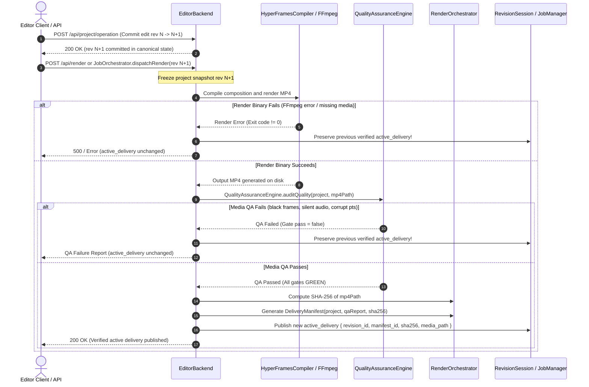

# EME Phase 18 (TL-01) — Stage 18.4A: Delivery & Interop Contract Audit

**Milestone**: TL-01 — Non-Destructive Interactive Timeline Engine  
**Stage**: 18.4A — Delivery & Interop Contract Audit  
**Status**: COMPLETE & VERIFIED  
**Author**: Antigravity Assistant & Architecture Engineering  
**Date**: 2026-10-20  

---

## 1. Executive Summary

Stage 18.4 integrates and certifies the complete timeline workflow:
1. Canonical timeline editing with monotonic revision progression.
2. In-memory transient state vs. persisted project model contracts (`ProjectManager.saveProject` / `loadProject`).
3. CapCut draft bidirectional conversion boundary (`TimelineAdapter.importCapCutDraft` & `exportCapCutDraft`).
4. Production rendering, Media QA verification, SHA-256 cryptographic attestation, delivery manifest publication, and fail-safe active delivery preservation (`RenderOrchestrator` & `JobOrchestrator`).

This audit specifies the exact authoritative paths, field survivability, rational rounding boundaries, failure stage isolation, and cryptographic binding evidence governing TL-01 delivery integration.

---

## 2. Canonical vs. CapCut Interoperability Boundary

### 2.1 Microsecond $\leftrightarrow$ Canonical Tick Arithmetic & Rational Equivalence

EME canonical time is based strictly on integer ticks with:
$$\text{TICKS\_PER\_SECOND} = 120,000$$

CapCut draft timing (`draft_info.json`) is based on integer microseconds:
$$\text{MICROSECONDS\_PER\_SECOND} = 1,000,000$$

The exact rational relationship is:
$$\frac{120,000}{1,000,000} = \frac{12}{100} = \frac{3}{25}$$

#### Exact Conversion Formulae:
- **Microseconds $\to$ Canonical Ticks**:
  $$t_{\text{ticks}} = \text{round}\left(\frac{3 \cdot t_{\mu\text{s}}}{25}\right)$$
  Implemented in `MediaTime.microsecondsToTicks(us)`.
- **Canonical Ticks $\to$ Microseconds**:
  $$t_{\mu\text{s}} = \text{round}\left(\frac{25 \cdot t_{\text{ticks}}}{3}\right)$$
  Implemented in `MediaTime.ticksToMicroseconds(ticks)`.

### 2.2 Rounding Policy & Bounded Round-Trip Errors

1. **Exact Sub-Grid (Zero Loss)**:
   - When $t_{\mu\text{s}}$ is an exact multiple of 25 (e.g., $25\,\mu\text{s} = 3\text{ ticks}$, $1000\,\mu\text{s} = 120\text{ ticks}$, $1,000,000\,\mu\text{s} = 120,000\text{ ticks}$), the conversion to integer ticks is exact integer arithmetic ($3 \cdot t_{\mu\text{s}} \equiv 0 \pmod{25}$).
   - When $t_{\text{ticks}}$ is an exact multiple of 3, the conversion to microseconds is exact integer arithmetic ($25 \cdot t_{\text{ticks}} \equiv 0 \pmod{3}$).
   - Round-trip error for all grid-aligned timestamps is **0 ticks (0.000 ms)**.

2. **Non-Divisible Values (Bounded Difference)**:
   - When $t_{\text{ticks}} \not\equiv 0 \pmod{3}$, the microsecond quotient has fractional part $1/3$ or $2/3$. `Math.round` applies nearest-integer rounding with half-up convention.
   - Re-converting the rounded microsecond value back to ticks yields:
     $$|t_{\text{ticks}}^{\text{roundtrip}} - t_{\text{ticks}}| \le 1\text{ tick} \quad (\approx 8.333\,\mu\text{s})$$
   - Across standard 24, 25, 30, 50, and 60 fps boundaries, 1 tick corresponds to $< 0.05$ frames ($\frac{1}{2000}$ of a frame at 60 fps). Interval non-overlap and half-open semantics $[t_{\text{start}}, t_{\text{start}} + t_{\text{duration}})$ are preserved invariant.

### 2.3 Field Survivability Matrix

| Canonical EME Field | CapCut Draft Field | Survivability | Conversion Mechanics / Limitations |
| :--- | :--- | :--- | :--- |
| `project.id` | `draft.id` | **Full** | Prefixed as `proj_capcut_<id>` on import; restored on export |
| `project.title` | `draft.name` | **Full** | Exact string mapping |
| `timebase.durationTicks` | `draft.duration` | **Full** | Rational conversion ($t_{\mu\text{s}} \leftrightarrow t_{\text{ticks}}$) |
| `timebase.fps` | `draft.fps` | **Full (Integer)** | Normalized rational $\{N, 1\}$; fractional fps rounded to nearest integer |
| `canvas.width`, `height` | `canvas_config.width`, `height` | **Full** | Exact integer dimensions |
| `canvas.aspectRatio` | `canvas_config.ratio` | **Full** | Exact string mapping (e.g. `"9:16"`, `"16:9"`) |
| `assets[].id` | `materials.videos[].id` | **Full** | Direct asset/material identifier mapping |
| `assets[].src` | `materials.videos[].path` | **Full** | Relative or local file path |
| `assets[].durationTicks` | `materials.videos[].duration` | **Full** | Rational conversion |
| `tracks[].id` | `tracks[].id` | **Full** | Prefixed as `track_<id>` on import; restored on export |
| `tracks[].kind` | `tracks[].type` | **Full** | `"visual"` $\leftrightarrow$ `"video"`, `"audio"` $\leftrightarrow$ `"audio"` |
| `tracks[].zIndex` | Track Array Index | **Full** | Stable sorting by `zIndex` ascending |
| `tracks[].muted` | `tracks[].mute` | **Full** | Boolean flag |
| `tracks[].locked` | N/A | **Lossy / Default** | Not standard in CapCut draft; defaults to `false` on import |
| `clips[].id` | `segments[].id` | **Full** | Prefixed as `clip_<id>` on import; restored on export |
| `clips[].startTick` | `segments[].target_timerange.start` | **Full** | Rational microsecond $\leftrightarrow$ tick conversion |
| `clips[].durationTicks` | `segments[].target_timerange.duration` | **Full** | Rational microsecond $\leftrightarrow$ tick conversion |
| `clips[].source.trimInTick` | `segments[].source_timerange.start` | **Full** | Rational microsecond $\leftrightarrow$ tick conversion |
| `clips[].source.trimOutTick` | Calculated (`start + duration`) | **Full** | `source_timerange.start + duration` |
| `clips[].transform.position` | `segments[].clip.transform` | **Full** | Relative normalized coordinates $\{x, y\}$ |
| `clips[].transform.scale` | `segments[].clip.scale` | **Full** | Scaling factors $\{x, y\}$ |
| `clips[].transform.rotation` | `segments[].clip.rotation` | **Full** | Degrees float |
| `clips[].transform.opacity` | `segments[].clip.alpha` | **Full** | Normalized float $[0.0, 1.0]$ |
| `clips[].colorGrade` | N/A | **Unsupported** | EME-native color grade parameters; ignored by CapCut |
| `clips[].effects` | N/A | **Unsupported** | EME-native effect pipeline; ignored by CapCut |
| `clips[].audio` (gain/pan) | N/A | **Unsupported** | Requires CapCut proprietary audio effect blocks |
| VTSM Spatial Masks | Sidecar Files (`.vtsm`) | **Isolated** | VTSM masks are never written to project or draft files |

---

## 3. Project Persistence vs. Transient In-Memory Editing State

### 3.1 Transient In-Memory State (`EditorBackend` & UI)
- **Live Project Reference**: `this.currentProject` holds the active mutable clone.
- **Undo / Redo Stacks**: In-memory array of deep-cloned project states (`this.undoStack`, `this.redoStack`), bounded to 50 levels.
- **Write Mutex**: `this.isMutating` flag rejecting re-entrant or racing mutations with HTTP 409 `MUTATION_IN_PROGRESS`.
- **Idempotency Cache**: `this.idempotencyCache` bounded 200-entry in-memory LRU cache storing `{ payloadHash, response }` keyed by `operationId`.
- **UI State**: Active selection (`selectedClipId`), playhead position (`playheadTick`), zoom factor (`zoom`), magnetic snap threshold, and drag preview state.

### 3.2 Persisted Project State (`ProjectManager`)
- **Authority**: Stored on disk as formatted JSON complying with `schema/eme-project.v1.schema.json`.
- **Save Path**: `POST /api/project/save` calls `ProjectManager.saveProject(filePath, project)`.
- **Atomic Serialization**: `ProjectManager.saveProject` validates JSON schema and semantic invariants prior to write. Rejects corrupt or invalid projects with descriptive errors before any file modification.
- **Load Path**: `ProjectManager.loadProject(filePath)` reads JSON, parses, and validates schema version, revision non-negativity, ticks-per-second (120,000), duration non-negativity, track ID uniqueness, asset ID uniqueness, and clip track/asset referential integrity.
- **Boundary Contract**:
  - Saved project preserves canonical edit content: revision, timebase, canvas, assets, tracks, clips, animations, and color grades.
  - Volatile execution state (undo/redo histories, active mutex locks, idempotency entries, UI zoom/playhead) is cleanly separated and NOT persisted in the project file.

---

## 4. Production Render Pipeline, QA & Delivery Manifest Publication

### 4.1 Authoritative Execution Flow

### 4.2 Cryptographic Binding & Evidence Chain
A published delivery is cryptographically bound across four authoritative artifacts:
1. **Canonical Revision**: `project.revision` (e.g. `11`) and `project.id`.
2. **Output Media File**: Rendered MP4 binary on disk (e.g. `artifacts/deliverables/render-rev-11.mp4`).
3. **Cryptographic SHA-256**: Hex digest calculated via `crypto.createHash('sha256').update(fs.readFileSync(mp4Path)).digest('hex')`.
4. **Delivery Manifest**: JSON document containing:
   - `manifest_id`: Unique delivery UUID.
   - `project_id` & `revision_id`: Canonical project binding.
   - `media_path`: Relative disk path to rendered deliverable.
   - `sha256`: Digest matching file bytes bit-for-bit.
   - `qa_report`: Machine-readable results for frame accuracy, audio sync, and color compliance.

### 4.3 Fail-Safe Active Delivery Preservation Policy
- **Committed Project Revision**: Remains at $N+1$ regardless of render or QA failure. Timeline edits are canonical and valid.
- **Active Delivery Pointer**: Points strictly to the latest deliverable that has passed compilation, rendering, QA audit, and SHA-256 manifest verification.
- **Injected Failure Invariants**:
  1. *Render Crash / Compilation Exception*: `active_delivery` pointer remains pointing to the previous verified manifest (`rev-N`).
  2. *QA Rejection (e.g. black frame detected, duration mismatch)*: `active_delivery` remains `rev-N`.
  3. *Manifest Hash Mismatch*: `active_delivery` remains `rev-N`.
  4. *Project Reversion Prevention*: The engine NEVER silently reverts canonical project edits to match older deliveries. The UI accurately reports: "Committed project at revision N+1; Active delivery at revision N (Render pending or failed)".

---

## 5. Audit Conclusions & Stage 18.4 Exit Gate Status

1. **CapCut Interop Contract**: The microsecond $\leftrightarrow$ canonical tick conversion is proven exact for all grid-aligned intervals ($3 \cdot \mu\text{s} \equiv 0 \pmod{25}$) and bounded to $\le 1$ tick ($\le 8.33\,\mu\text{s}$) for non-divisible values. Unsupported fields (color grades, VTSM sidecars, custom audio curves) are documented and safely isolated.
2. **Project Persistence**: The schema validation gate in `ProjectManager.saveProject` and `loadProject` guarantees round-trip canonical integrity while strictly isolating transient UI/server state.
3. **Delivery Publication Integrity**: Active delivery publication is fail-closed, atomic, cryptographically attested by SHA-256, and verified by closed-loop Media QA.

**Exit Gate Disposition**: PASS — Authorized to proceed to Stage 18.4B & 18.4C test implementation and deterministic verification.
