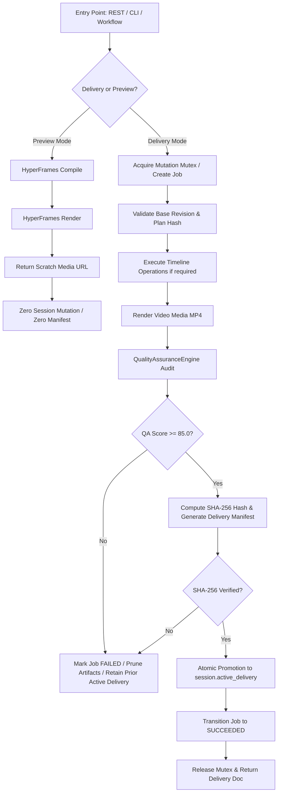

# Phase 19 (RT-01) — Stage 19.4 Closed-Loop Delivery Contract

**Milestone**: RT-01 — End-to-End Workflow Integration & Final Delivery  
**Stage**: Stage 19.4 — Closed-Loop Delivery Path Unification & CLI/REST Certification  
**Document**: `plans/PHASE_19_STAGE4_DELIVERY_CONTRACT.md`  
**Governing Directives**:
- `plans/CHATGPT_STAGE19_3_FINAL_CERTIFICATION.md` (Stage 19.4 Authorization & Closure Gates)
- `plans/PHASE_19_STAGE3_RECOVERY_MATRIX.md` (Authoritative 12-State Recovery Baseline)
- `schema/eme-delivery-manifest.v1.schema.json`
- `schema/eme-delivery-run.v1.schema.json`

---

## 1. Executive Summary & Purpose

The purpose of Stage 19.4 is to unify **all deliverable-producing entry points** across the Editing Mechanics Engine (EME) under **one authoritative closed-loop delivery pipeline**. 

Prior to Stage 19.4, high-level conversational prompt revisions flowed through `EndToEndOrchestrator` and `RenderOrchestrator`, while direct HTTP endpoints (`POST /api/render`) and CLI commands (`eme render`) invoked low-level compilers and renderers (`HyperFramesCompiler`, `HyperFramesRenderer`) directly. This created a dual-authority seam where direct render requests could produce output without Media QA verification, cryptographic manifest anchoring, or session active delivery tracking.

Stage 19.4 eliminates this dual path:
1. **Single Delivery Authority**: All production deliveries must traverse the canonical closed-loop validation pipeline.
2. **Preview Isolation**: Preview renders for visual playback are strictly isolated from final production deliveries and cannot promote `session.active_delivery`.
3. **Multi-Surface Parity**: REST (`/api/render`), CLI (`eme render`, `eme prompt render`), and Orchestrated Workflows (`runWorkflow`) achieve full behavioral and schema parity.

---

## 2. Canonical Closed-Loop Delivery Pipeline

Every final deliverable generated by EME must strictly follow the immutable 8-stage sequence:

$$\text{Request} \longrightarrow \text{Durable Job} \longrightarrow \text{Project Snapshot} \longrightarrow \text{Media Render} \longrightarrow \text{Media QA Audit} \longrightarrow \text{Manifest \& Hash Verification} \longrightarrow \text{Active-Delivery Publication} \longrightarrow \text{Terminal SUCCEEDED}$$

### 2.1 The Seven Mandatory Gates:
1. **Intake & Idempotency Gate**: Re-entrant requests with identical idempotency key return cached delivery without re-render. Conflicting requests fail with `409 IDEMPOTENCY_CONFLICT`.
2. **Base Revision & Currency Gate**: Live project revision must match requested base revision; diverged state fails closed with `409 STALE_REVISION`.
3. **Execution Gate**: Operation execution is protected by `this.isMutating` mutex. Partial failure (`atomic: false`) accurately records committed steps.
4. **Render Verification Gate**: Render output must exist, be non-empty, and validate container format (MP4/H.264/AAC).
5. **Media QA Gate**: Independent audit via `QualityAssuranceEngine` must meet or exceed the delivery threshold ($\ge 85.0$). Any regression triggers immediate delivery abort.
6. **Cryptographic Manifest Gate**: Full SHA-256 fingerprint computed for media and validated against `eme-delivery-manifest.v1.schema.json`.
7. **Atomic Publication Gate**: `session.active_delivery` pointer is only updated after all 6 preceding gates succeed. Any failure leaves prior verified delivery 100% untouched.

---

## 3. Entry Point Specifications & Contract Unification

| Surface | Command / Endpoint | Mode | Delivery Authority | QA Audit ($\ge 85.0$) | Manifest Generated | Active Delivery Updated |
|---|---|---|---|---|---|---|
| **REST** | `POST /api/render` (`mode: 'deliver'`) | Final Delivery | Canonical Pipeline | **Mandatory** | **Mandatory** | **Yes** |
| **REST** | `POST /api/render` (`mode: 'preview'`) | Scratch Preview | Isolated Preview | None | None | **No** (Untouched) |
| **REST** | `POST /api/jobs` | Orchestrated | Canonical Pipeline | **Mandatory** | **Mandatory** | **Yes** |
| **CLI** | `eme render <proj> --deliver` | Final Delivery | Canonical Pipeline | **Mandatory** | **Mandatory** | **Yes** (when session present) |
| **CLI** | `eme render <proj>` (default) | Scratch Preview | Isolated Preview | None | None | **No** (Untouched) |
| **CLI** | `eme prompt render` | Final Delivery | Canonical Pipeline | **Mandatory** | **Mandatory** | **Yes** |

---

## 4. Preview vs Delivery Isolation Contract

To prevent confusion between interactive UI scrubber playback and client deliverables:

1. **Preview Isolation Guarantees**:
   - Output written to temporary scratch paths (`artifacts/ui-renders/preview-*.mp4`).
   - Does **NOT** increment project revision.
   - Does **NOT** generate a delivery manifest document.
   - Does **NOT** alter `session.active_delivery`.
   - Returns `{ success: true, preview: true, mp4Path, active_delivery: null }`.

2. **Delivery Guarantees**:
   - Output written to durable deliverable directory (`artifacts/deliverables/*.mp4`).
   - Anchored to immutable snapshot revision $R$.
   - Validated against Media QA threshold ($\ge 85.0$).
   - Cryptographically fingerprinted with SHA-256.
   - Updates `session.active_delivery` with immutable run identity.
   - Records lineage node in `session.history`.

---

## 5. Twelve Golden Delivery Scenarios (A through L)

The Stage 19.4 test suite (`tests/workflow-stage19-4-delivery.test.js`) verifies the following 12 canonical scenarios:

- **Scenario A (Direct REST Delivery)**: `POST /api/render` in delivery mode traverses full closed-loop pipeline with QA, manifest, and active delivery promotion.
- **Scenario B (Orchestration Parity)**: Direct delivery and prompt workflow delivery produce structurally identical delivery run docs and manifest artifacts.
- **Scenario C (Supported CLI Parity)**: CLI `eme render --deliver` and `eme prompt render` invoke canonical delivery pipeline with compliant exit codes.
- **Scenario D (Preview Isolation)**: Preview rendering generates playable MP4 but preserves `session.active_delivery` without generating delivery manifests.
- **Scenario E (Render Subprocess Failure)**: Renderer failure cleans up scratch media and preserves prior verified active delivery.
- **Scenario F (Media QA Threshold Failure)**: Render scoring below 85.0 aborts delivery publication and preserves prior active delivery.
- **Scenario G (Manifest / Hash Integrity Failure)**: Diverged SHA-256 or corrupt manifest prevents deliverable promotion.
- **Scenario H (Duplicate Delivery Request / Idempotency)**: Re-entrant delivery request returns cached delivery run without duplicate rendering.
- **Scenario I (Lost Response Recovery)**: Recovering an already-committed delivery returns verified deliverable without redundant execution.
- **Scenario J (Restart During Delivery)**: Service restart during `RENDERING` or `PUBLISHING` recovers safely without unverified promotion.
- **Scenario K (Concurrent Project Edit During Delivery)**: Concurrent live timeline mutation while rendering does not corrupt snapshot delivery or live project.
- **Scenario L (Last-Known-Good Preservation Across Battery)**: Multiple consecutive delivery failures across REST, CLI, and workflow leave initial active delivery 100% intact.
